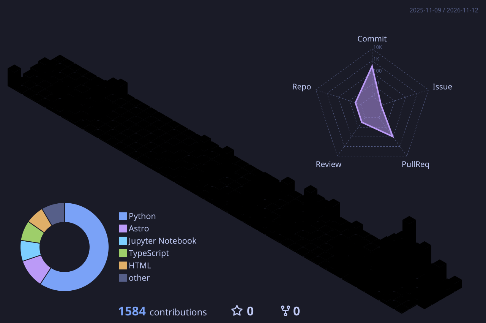
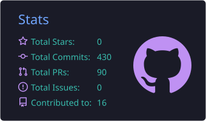

<h1 align="center">
  
</h1>

  
  
  
  
  
  

## About Me

I'm **Trung Nguyen**, from Vietnam, a final-year Artificial Intelligence student at [VNU-HCM University of Science](https://en.hcmus.edu.vn/) with a deep passion for **Multimodal AI**. I build retrieval systems end to end: RAG and GraphRAG, LLM agents, video retrieval, and document OCR.

📄 Co-author of [KPTER](https://doi.org/10.1007/978-981-92-2587-3_24) (Springer, SOICT 2025)

🏆 2nd Prize, ICPC Southern Region 2024 & Consolation Prize, Vietnamese National Informatics Olympiad 2023

🌐 You can find more about me and my projects at **[htrung1105.github.io](https://htrung1105.github.io)**.

## Tech Stack

  
  
  
  
  
  
  
  
  
  

## Statistics

  

  
  
  

<picture>
  <source media="(prefers-color-scheme: dark)" srcset="https://raw.githubusercontent.com/htrung1105/htrung1105/output/github-snake-dark.svg">
  <source media="(prefers-color-scheme: light)" srcset="https://raw.githubusercontent.com/htrung1105/htrung1105/output/github-snake.svg">
  
</picture>
