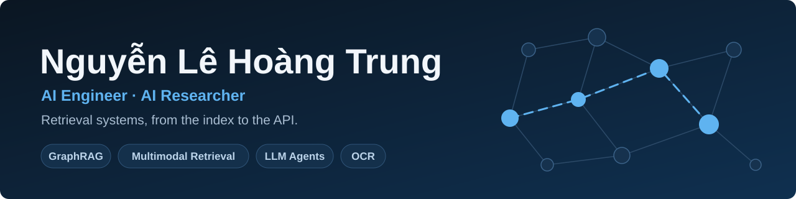

  

  
  
  

  

Final-year Artificial Intelligence student at VNU-HCM University of Science. I build retrieval systems end to end: RAG and GraphRAG, LLM agents, and document OCR. I am looking for an AI Engineer internship.

<table>
  <tr>
    <td align="center" width="25%"><h3>353,746</h3>legal documents in the GraphRAG knowledge graph</td>
    <td align="center" width="25%"><h3>+30.2%</h3>OCR H-mean on NomNaOCR (0.731 to 0.952)</td>
    <td align="center" width="25%"><h3>Best Presentation</h3>SOICT 2025</td>
    <td align="center" width="25%"><h3>2nd Prize</h3>ICPC Southern Region 2024</td>
  </tr>
</table>

## Selected work

### [Vietnamese Legal GraphRAG](https://github.com/ductai05/VietLegalGraphRAG) · [demo video](https://www.youtube.com/watch?v=CkdYwaeIEU8)

Legal Q&A with structured citations and expiry warnings, built by a team of five. 353,746 documents become about 7.48 million chunks, searched through Elasticsearch and expanded through a Neo4j knowledge graph.

`Legal question` → `Hybrid search (BM25 + dense)` → `RRF and reranking` → `Neo4j graph expansion` → `LLM answer` → `Structured citations`

**My part:** the knowledge graph pipeline, hybrid retrieval and its evaluation scripts, the LangGraph agent service, and CI/CD.

### [KPTER: K-Pointer for Temporal Event Retrieval](https://doi.org/10.1007/978-981-92-2587-3_24)

Zero-shot event retrieval over video, combining OCR, ASR, semantic embeddings and object detection. Published in Springer CCIS vol. 2913 (SOICT 2025). Team WATLERE ranked Top 12 of 80+ at AI Challenge HCMC 2025.

**My part:** co-author with equal contribution. I worked on the multimodal indexing pipeline and the search backend and API.

### [Sino-Nom Historical OCR](https://github.com/ductai05/NLP-ChineseOCR)

Text detection for degraded Sino-Nom documents using a fine-tuned PP-OCRv5 model. H-mean rose from 0.731 to 0.952, with 0.966 precision on the NomNaOCR test set.

**My part:** the fine-tuning and evaluation notebooks.

### [TradingClaw](https://github.com/ductai05/TradingClaw)

A team-built trading assistant that runs against the Binance Testnet sandbox.

**My part:** the FastAPI backend, the gateway to the ML services (FinBERT, Kronos, Isolation Forest), Gemini integration, and per-request LLM token and cost logging.

## Tools

  

Also: LangChain · LangGraph · GraphRAG · Neo4j · PaddlePaddle · SQL

## Honors

- **Best Presentation Award**, SOICT 2025
- **2nd Prize**, ICPC Southern Region 2024, and contestant at the ICPC Vietnam National round
- **Consolation Prize**, Vietnamese National Olympiad in Informatics 2023

<picture>
  <source media="(prefers-color-scheme: dark)" srcset="https://raw.githubusercontent.com/htrung1105/htrung1105/output/github-snake-dark.svg">
  <source media="(prefers-color-scheme: light)" srcset="https://raw.githubusercontent.com/htrung1105/htrung1105/output/github-snake.svg">
  
</picture>
